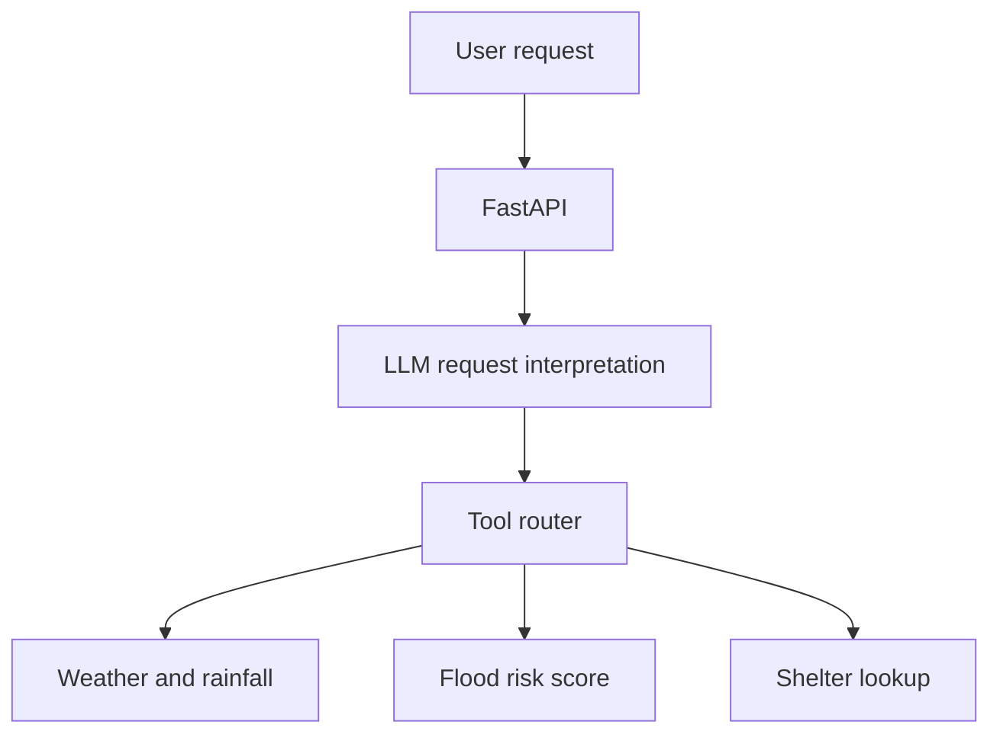

# Flood MCP — AI-assisted flood risk assessment prototype

기상·지형 정보와 자연어 요청을 연결하는 재난 대응 연구 프로토타입입니다.

## Implementation
- FastAPI: `/healthz`, `/version`, `/query`, `/api/flood-info`, `/api/flood-risk/by-city`.
- Claude 3 Haiku 기반 자연어 요청 해석 및 자체 도구 라우팅.
- 도시명/좌표 기반 기상·강수량 조회, 강수와 저지대 조건에 따른 규칙 기반 위험 점수.
- 대피소 거리 계산과 대피 경로 응답 구조 탐색.

## Repository guide
- `main.py`: API entry point
- `mcp_core/`: agent, Claude client, router, executor
- `tools/`: weather, flood risk and evacuation functions
- `data/`: sample flood data

## Reproduction status
The current default branch references request models and elevation modules not present in its file tree. A clean-clone run has not been verified; restore missing modules and dependency declarations before attempting execution. Keep provider credentials in environment variables (e.g. `ANTHROPIC_API_KEY`).

## Scope and limitations
Custom LLM routing is not proof of native MCP protocol compliance. The rule-based risk score is not a validated flood forecasting model; route integration is incomplete. This is a research prototype, not an emergency decision service.
